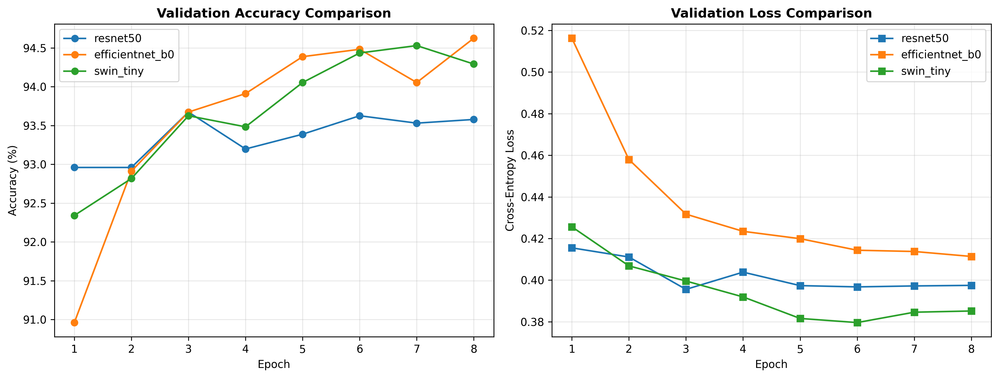
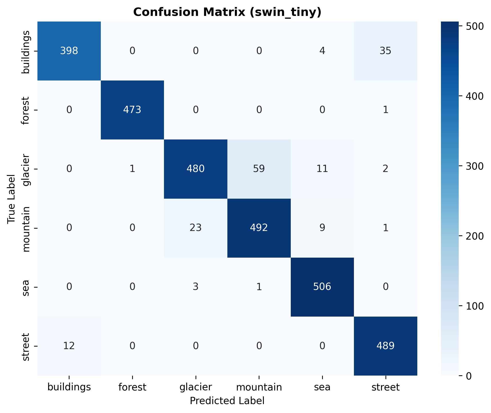
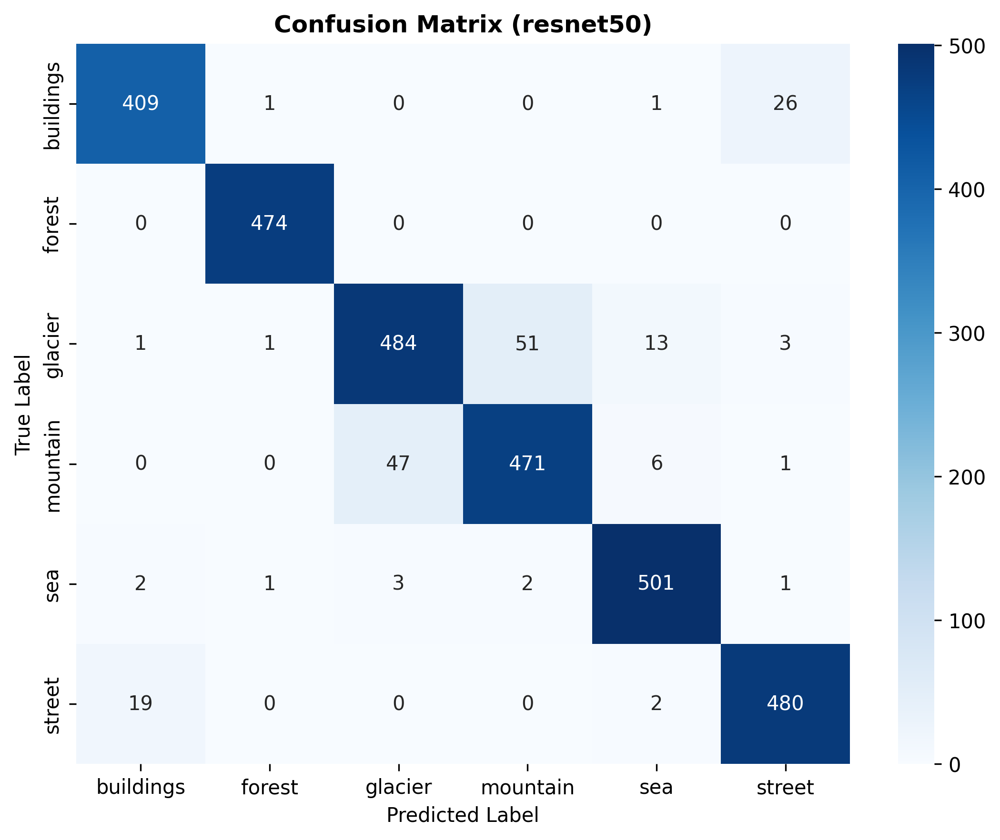
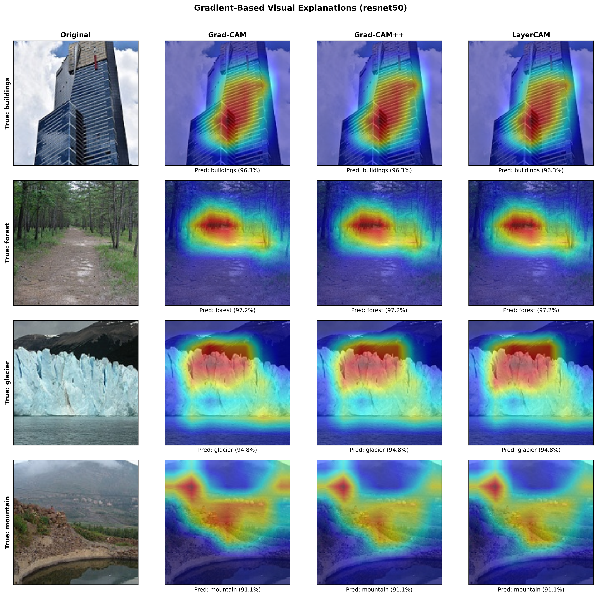
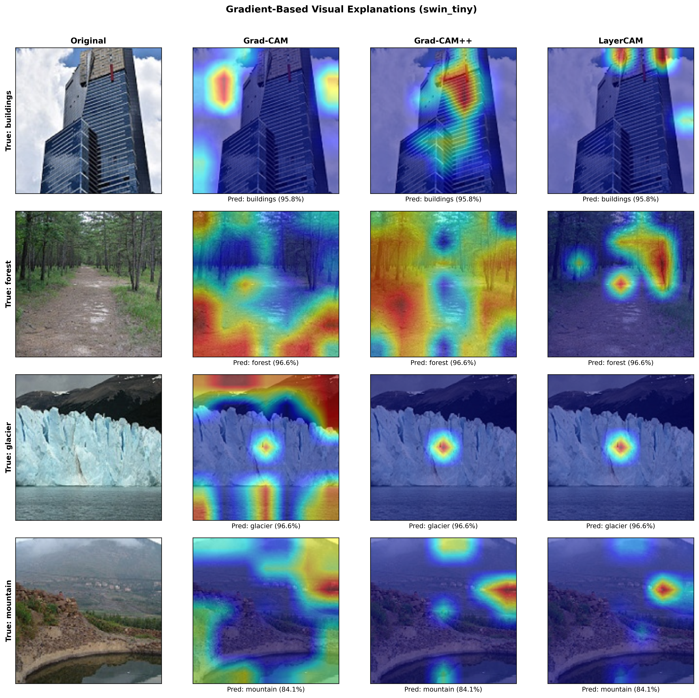
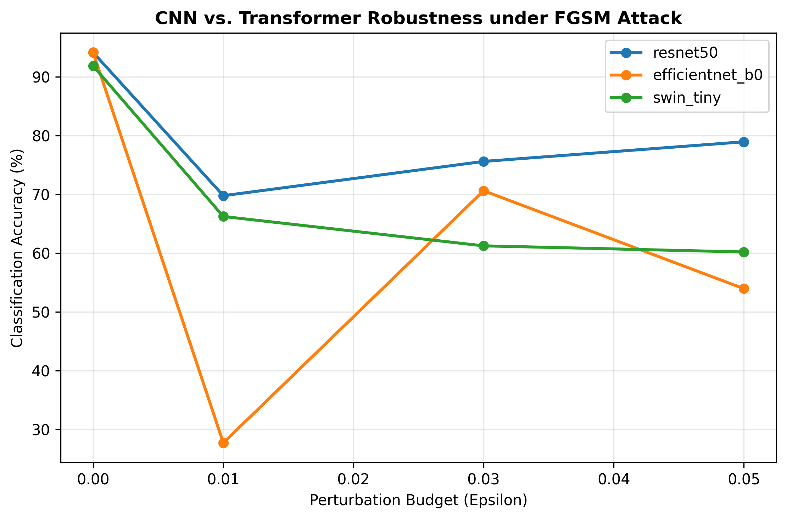
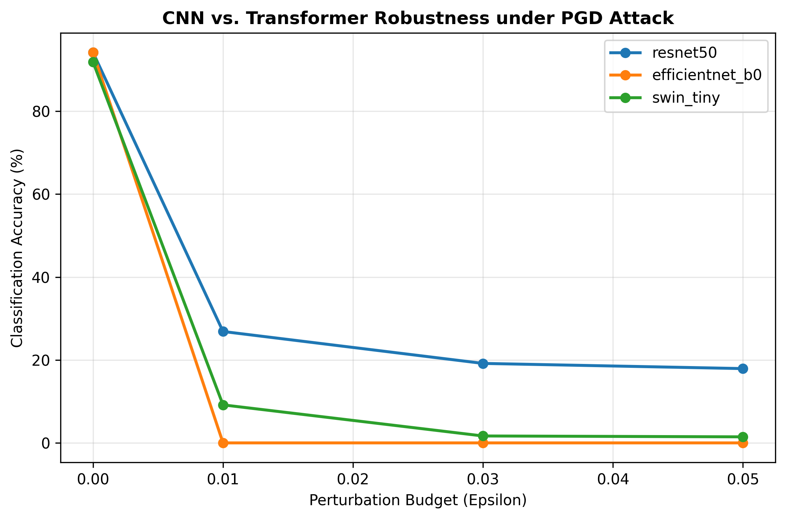
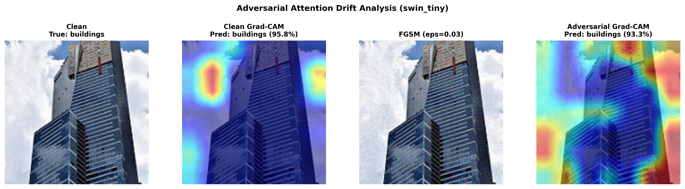
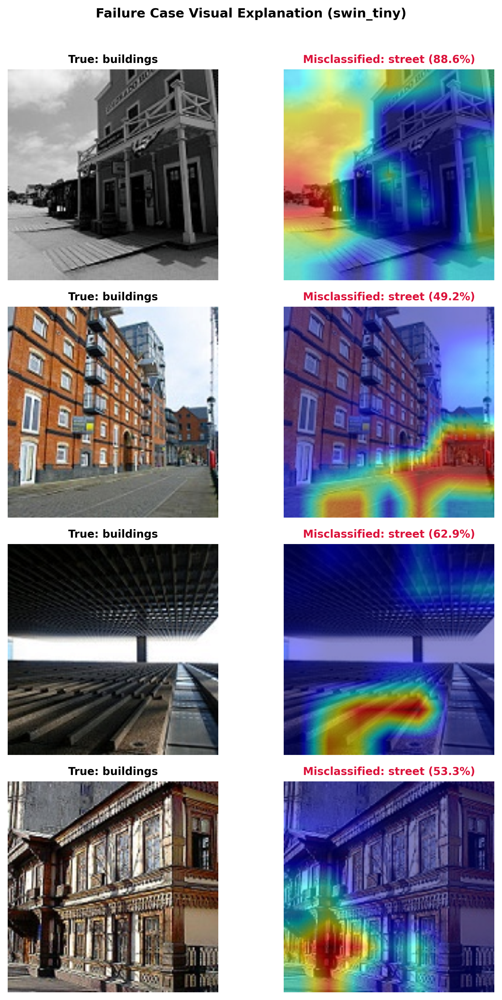

# Explainable Multi-Class Scene Recognition from Natural Images Using Deep Learning and Gradient-Based Visual Explanation

[](https://colab.research.google.com/github/matiur-rahman1/explainable-scene-recognition/blob/main/notebooks/explainable_scene_recognition_colab.ipynb)


A modular, reproducible PyTorch research framework comparing **Convolutional Neural Networks (`ResNet-50`, `EfficientNet-B0`)** and **Vision Transformers (`Swin-Tiny`)** for multi-class natural scene recognition, paired with **gradient-based visual explanations (`Grad-CAM`, `Grad-CAM++`, `LayerCAM`)**, **quantitative XAI faithfulness evaluation (`Insertion/Deletion AUC`)**, and **adversarial robustness analysis (`FGSM`, `PGD`)**.

---

## 1. Experimental Results (Intel Natural Scenes — 6 Classes, 2x Tesla T4 GPU)

### 1.1 Classification Performance & Model Efficiency

| Architecture | Family | Test Accuracy | Macro-F1 | Weighted-F1 | Params (M) | Latency (ms/img) |
| :--- | :---: | :---: | :---: | :---: | :---: | :---: |
| **`swin_tiny`** | Vision Transformer | **94.60%** | **94.69%** | **94.57%** | 27.52M | 11.34 ms |
| **`resnet50`** | CNN | 93.97% | 94.11% | 93.94% | 23.52M | **5.96 ms** |
| **`efficientnet_b0`** | Lightweight CNN | 93.87% | 94.00% | 93.85% | **4.02M** | 8.24 ms |

<p align="center">
  
</p>

<p align="center">
  
  
</p>

---

### 1.2 Quantitative XAI Faithfulness (Insertion ↑ / Deletion ↓ AUC)

Evaluated over 40 test images across 20 progressive perturbation steps using a blurred baseline:

| Model | Grad-CAM (Ins ↑ / Del ↓) | Grad-CAM++ (Ins ↑ / Del ↓) | LayerCAM (Ins ↑ / Del ↓) |
| :--- | :---: | :---: | :---: |
| **`resnet50`** | **0.8405** / **0.5538** | 0.8326 / 0.5664 | 0.8304 / 0.5764 |
| **`efficientnet_b0`** | **0.7441** / **0.6560** | 0.6751 / 0.7441 | 0.7266 / 0.6924 |
| **`swin_tiny`** | 0.6031 / 0.6710 | **0.7666** / **0.4899** | 0.7440 / 0.6203 |

> **Key Finding:** While `Swin-Tiny` achieves the highest classification accuracy (`94.60%`), `ResNet-50` yields the sharpest spatially localized Grad-CAM maps (`0.8405` Insertion AUC). On `Swin-Tiny`, **Grad-CAM++** (`0.7666` Insertion AUC, `0.4899` Deletion AUC) significantly outperforms standard Grad-CAM (`0.6031`), showing that second-order gradient weighting better captures hierarchical shifted-window attention.

#### Visual Explanation Comparison (`Original | Grad-CAM | Grad-CAM++ | LayerCAM`)

<p align="center">
  
</p>

<p align="center">
  
</p>

---

### 1.3 Adversarial Robustness (`FGSM` & `PGD-$L_\infty$`) & Failure Case Analysis

Accuracy evaluated on test batches under increasing perturbation budgets ($\epsilon \in \{0.0, 0.01, 0.03, 0.05\}$):

| Model | Clean ($\epsilon=0$) | FGSM ($\epsilon=0.01$) | FGSM ($\epsilon=0.03$) | PGD ($\epsilon=0.01$) | PGD ($\epsilon=0.03$) | PGD ($\epsilon=0.05$) |
| :--- | :---: | :---: | :---: | :---: | :---: | :---: |
| **`resnet50`** | **94.17%** | **69.79%** | **75.62%** | **26.87%** | **19.17%** | **17.92%** |
| **`swin_tiny`** | 91.87% | 66.25% | 61.25% | 9.17% | 1.67% | 1.46% |
| **`efficientnet_b0`** | **94.17%** | 27.71% | 70.63% | 0.00% | 0.00% | 0.00% |

<p align="center">
  
  
</p>

#### Adversarial Attention Drift & Natural Misclassification Analysis

<p align="center">
  
</p>

<p align="center">
  
</p>

---

## 2. Project Structure

```text
explainable-scene-recognition/
├── app.py                                           # Interactive Gradio demo
├── main.py                                          # End-to-end benchmark & XAI pipeline
├── requirements.txt                                 # Minimal runtime dependencies
├── assets/                                          # 300-DPI benchmark figures & summary JSON
├── notebooks/
│   └── explainable_scene_recognition_colab.ipynb    # One-click Google Colab GPU notebook
└── src/
    ├── __init__.py
    ├── dataset.py                                   # Intel Natural Scenes / SUN397 / Custom loader
    ├── models.py                                    # timm model factory & CAM target layer hooks
    ├── trainer.py                                   # AMP training loop, checkpointing & metrics
    ├── xai.py                                       # Grad-CAM, Grad-CAM++, LayerCAM & Insertion/Deletion AUC
    ├── adversarial.py                               # FGSM & PGD attacks in normalized pixel space
    └── visualize.py                                 # 300-DPI publication-quality figures
```

---

## 3. Quick Start

Click the **Open In Colab** badge at the top (with **T4 GPU** enabled), or run on **Kaggle / Local GPU**:

```bash
# 1. Install dependencies
pip install -r requirements.txt

# 2. Run full benchmark (Intel Natural Scenes: ResNet-50 vs. EfficientNet-B0 vs. Swin-Tiny)
python main.py --dataset intel --models resnet50 efficientnet_b0 swin_tiny --epochs 8 --batch-size 32

# 3. Optional: Scale up to SUN397 or a custom ImageFolder dataset
python main.py --dataset sun397 --epochs 10

# 4. Launch the interactive Gradio demo
python app.py
```

---

## Author

**MD Matiur Rahman**  
BEng Computer Science & Technology, Nantong University, China (2026)  
GitHub: [github.com/matiur-rahman1](https://github.com/matiur-rahman1) | Email: matiurrahman1353@gmail.com
