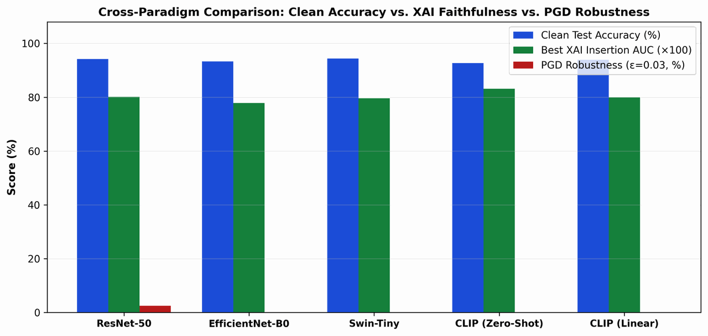
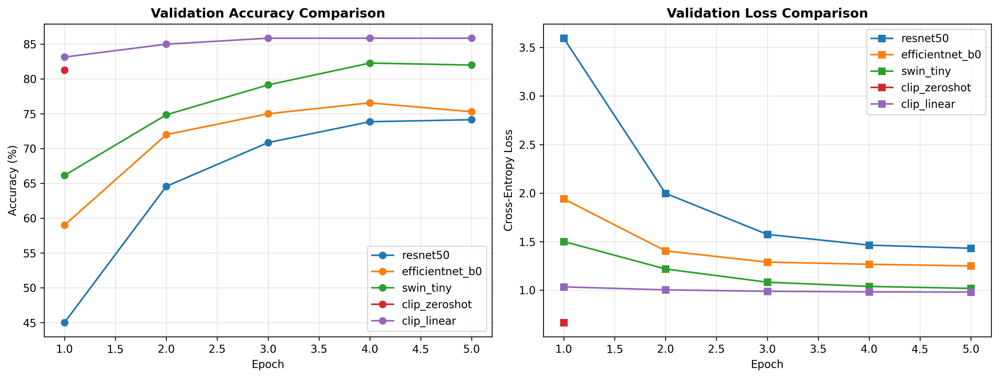
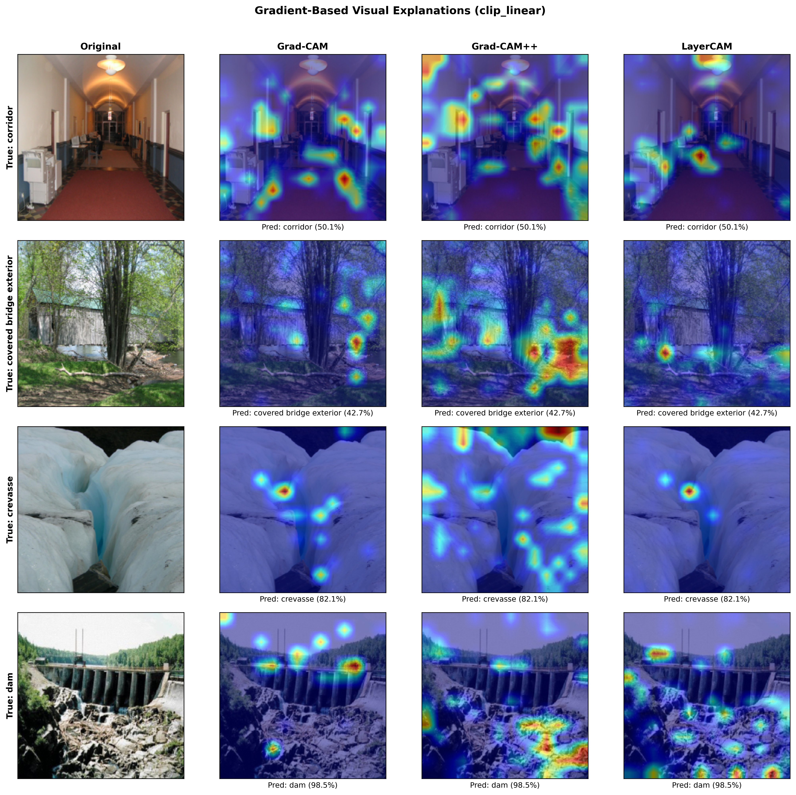

# Explainable Deep Learning for Scene Classification and Pattern Recognition

[](https://colab.research.google.com/github/matiur-rahman1/explainable-scene-recognition/blob/main/notebooks/explainable_scene_recognition_colab.ipynb)


A modular, reproducible PyTorch research framework comparing **Convolutional Neural Networks (`ResNet-50`, `EfficientNet-B0`)**, **Vision Transformers (`Swin-Tiny`)**, and **Contrastive Vision-Language Models (`CLIP ViT-B/16`)** for multi-class natural scene recognition, paired with **gradient-based visual explanations (`Grad-CAM`, `Grad-CAM++`, `LayerCAM`)**, **quantitative XAI faithfulness evaluation (`Insertion/Deletion AUC`)**, **adversarial robustness analysis (`FGSM`, `FGSM_pred`, `PGD`)**, **PGD adversarial training (`PGD-AT`)**, and **paired McNemar statistical tests**.

---

## 1. Multi-Seed Benchmark Results (Intel Natural Scenes — Seeds `0, 1, 2`)

### 1.1 Classification, Efficiency & XAI Faithfulness (Stratified 3-Seed Mean ± Std)

| Architecture | Paradigm | Test Acc. (%) | Macro-F1 (%) | Params (M) | Grad-CAM (Ins ↑ / Del ↓) | Grad-CAM++ (Ins ↑ / Del ↓) | LayerCAM (Ins ↑ / Del ↓) |
| :--- | :---: | :---: | :---: | :---: | :---: | :---: | :---: |
| **`swin_tiny`** | Hierarchical ViT | **94.40 ± 0.21** | **94.51 ± 0.20** | 27.52 | 0.6854 / 0.7484 | 0.7810 / 0.6563 | **0.7964** / 0.6807 |
| **`resnet50`** | Residual CNN | 94.18 ± 0.19 | 94.30 ± 0.18 | 23.52 | 0.8015 / **0.6071** | **0.7967** / **0.6193** | 0.7935 / **0.6242** |
| **`clip_linear`** | VLM (Linear Probe) | 93.97 ± 0.03 | 94.11 ± 0.03 | 86.20 | 0.7997 / 0.6954 | 0.7539 / 0.7338 | 0.7081 / 0.7955 |
| **`efficientnet_b0`** | Lightweight CNN | 93.31 ± 0.30 | 93.43 ± 0.29 | **4.02** | 0.7787 / 0.6395 | 0.6760 / 0.7484 | 0.7115 / 0.7093 |
| **`clip_zeroshot`** | VLM (Prompt Ens.) | 92.70 ± 0.00 | 92.80 ± 0.00 | 86.19 | **0.8312** / 0.7165 | 0.7937 / 0.7479 | 0.7408 / 0.8183 |

<p align="center">
  
</p>

### 1.2 PGD Adversarial Training (`PGD-AT`, $\epsilon=0.03$) on Intel Natural Scenes

| Model | Clean Acc. (%) | PGD ($\epsilon=0.01$) | PGD ($\epsilon=0.03$) | Grad-CAM Ins ↑ | LayerCAM Ins ↑ |
| :--- | :---: | :---: | :---: | :---: | :---: |
| `resnet50` (Clean) | 94.18% | 6.72% | 2.44% | **0.8015** | **0.7935** |
| `resnet50 + PGD-AT` | 88.33% | 18.67% | 5.83% | 0.6300 | 0.6218 |
| `swin_tiny` (Clean) | **94.40%** | 4.11% | 0.06% | 0.6854 | **0.7964** |
| **`swin_tiny + PGD-AT`** | **93.27%** | **67.33%** | **37.50%** | **0.6924** | 0.7916 |

---

## 2. Large-Scale Generalization (`SUN397-100` — 100 Classes, 5,000 Test Images)

| Architecture | Test Acc. (%) | Macro-F1 (%) | Grad-CAM (Ins ↑ / Del ↓) | LayerCAM (Ins ↑ / Del ↓) | FGSM (.03) | PGD (.03) |
| :--- | :---: | :---: | :---: | :---: | :---: | :---: |
| **`clip_linear`** | **86.02%** | **85.81%** | 0.4751 / 0.3187 | 0.3504 / 0.4193 | 16.20% | 0.00% |
| **`clip_zeroshot`** | 82.16% | 81.36% | 0.4520 / 0.3086 | 0.3368 / 0.4010 | 15.40% | 0.00% |
| **`swin_tiny`** | 79.44% | 79.35% | **0.5518** / 0.3980 | **0.5724** / 0.3859 | 8.00% | 0.00% |
| **`efficientnet_b0`** | 73.38% | 73.34% | 0.4436 / 0.1836 | 0.4134 / 0.1967 | 7.20% | 0.00% |
| **`resnet50`** | 71.14% | 70.28% | 0.3618 / **0.1293** | 0.3489 / **0.1359** | **22.00%** | **0.20%** |

<p align="center">
  
  
</p>

---

## 3. Repository Structure

```text
explainable-scene-recognition/
├── app.py                              # Interactive Gradio demo
├── main.py                             # Multi-seed benchmark, CLIP, PGD-AT & McNemar runner
├── requirements.txt                    # Dependencies
├── paper/                              # IEEE Access LaTeX manuscript, BibTeX, figures, tables
│   ├── main.tex
│   ├── references.bib
│   ├── cover_letter.tex
│   ├── highlights.md
│   ├── self_review.md
│   └── figures/                        # 300-DPI publication figures
├── results/                            # Reproducible JSON logs & split configs
├── scripts/
│   ├── make_tables.py                  # Auto-generates LaTeX tables from results/
│   ├── make_figures.py                 # Generates 300-DPI pipeline & comparison charts
│   └── run_stage2.py                   # Stage 2 runner (PGD-AT + SUN397-100)
└── src/
    ├── dataset.py                      # Intel / SUN397-100 / Custom ImageFolder loaders
    ├── models.py                       # timm & CLIP factory + CAM target layer hooks
    ├── clip_model.py                   # CLIP ViT-B/16 Zero-Shot & Linear-Probe wrappers
    ├── trainer.py                      # AMP training loop, checkpoint resume & metrics
    ├── xai.py                          # Grad-CAM, Grad-CAM++, LayerCAM & Insertion/Deletion AUC
    ├── adversarial.py                  # FGSM, FGSM_pred, PGD & PGD-AT
    ├── stats.py                        # Pairwise McNemar test & multi-seed aggregation
    ├── utils.py                        # Global seed locking & class-stratified sampling
    └── visualize.py                    # 300-DPI publication-quality figures
```

---

## 4. Quick Start

```bash
pip install -r requirements.txt

# 3-seed Intel Natural Scenes benchmark (CNNs + Swin-Tiny + CLIP ViT-B/16)
python main.py --dataset intel --models resnet50 efficientnet_b0 swin_tiny clip_zeroshot clip_linear --seeds 0 1 2 --epochs 6

# Stage 2: PGD Adversarial Training + 100-Class SUN397 Protocol
python scripts/run_stage2.py

# Interactive Gradio demo
python app.py
```

---

## 5. Citation

If you find this benchmark or codebase useful in your research, please cite:

```bibtex
@article{rahman2026explainable_scene,
  author  = {Rahman, MD Matiur},
  title   = {Accuracy, Faithfulness, and Robustness: An Explainable Benchmark of CNNs, Vision Transformers, and Vision-Language Models for Scene Recognition},
  year    = {2026},
  url     = {https://github.com/matiur-rahman1/explainable-scene-recognition}
}
```
