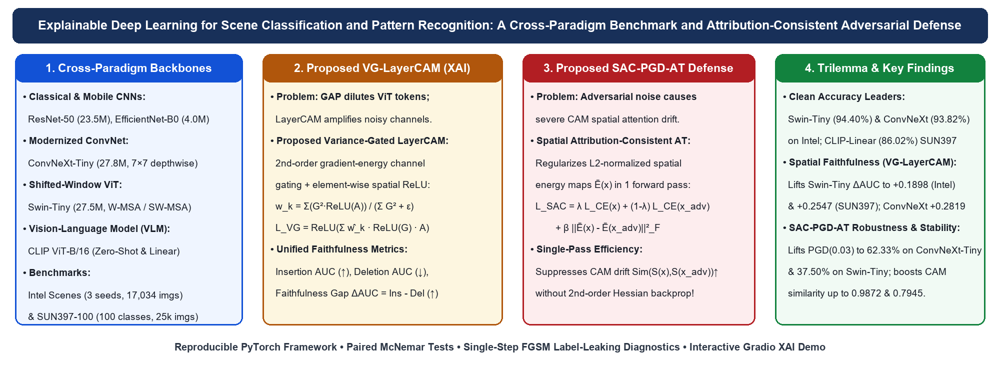
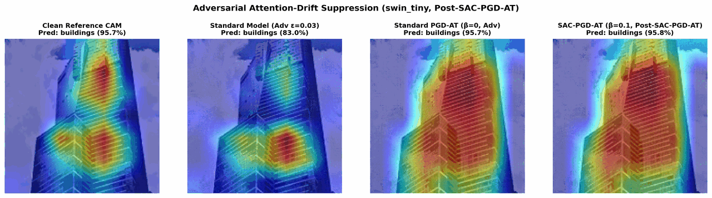

# Explainable Deep Learning for Scene Classification and Pattern Recognition

[](https://colab.research.google.com/github/matiur-rahman1/explainable-scene-recognition/blob/main/notebooks/explainable_scene_recognition_colab.ipynb)


Official PyTorch implementation for **"Explainable Deep Learning for Scene Classification and Pattern Recognition: A Cross-Paradigm Benchmark and Attribution-Consistent Adversarial Defense"** (*Neurocomputing* submission).

This repository benchmarks six architectures across three paradigms—**Classical & Mobile CNNs (`ResNet-50`, `EfficientNet-B0`)**, **Modernized ConvNet (`ConvNeXt-Tiny`)**, **Hierarchical Vision Transformer (`Swin-Tiny`)**, and **Contrastive Vision-Language Models (`CLIP ViT-B/16` Zero-Shot & Linear Probe)**—and introduces two methodological contributions:
1. **Variance-Gated LayerCAM (`VG-LayerCAM`):** Couples second-order gradient-energy channel gating with element-wise spatial positive gradients to suppress noisy background channels while preserving fine-grained token attribution.
2. **Spatial Attribution-Consistent Adversarial Training (`SAC-PGD-AT`):** Regularizes L2-normalized target-layer spatial energy maps ($\beta \|\bar{E}(x) - \bar{E}(x_{\text{PGD}})\|_F^2$) in a single forward pass to suppress adversarial attention drift while boosting $\text{PGD-}L_\infty$ robustness.

<p align="center">
  
</p>

---

## 1. Multi-Seed Six-Architecture Benchmark (Intel Natural Scenes — Seeds `0, 1, 2`)

| Architecture | Paradigm (Params) | Test Acc. (%) | Macro-F1 (%) | Grad-CAM (Ins↑/Del↓) | LayerCAM (Ins↑/Del↓) | **VG-LayerCAM (Ours) (Ins↑/Del↓/$\Delta\text{AUC}$↑)** |
| :--- | :---: | :---: | :---: | :---: | :---: | :---: |
| **`swin_tiny`** | Shifted-Window ViT (27.5M) | **94.40 ± 0.21** | **94.51 ± 0.20** | 0.6854 / 0.7484 | 0.7964 / 0.6807 | **0.8175 / 0.6278 / +0.1898** |
| **`resnet50`** | Residual CNN (23.5M) | 94.18 ± 0.19 | 94.30 ± 0.18 | 0.8015 / 0.6071 | 0.7935 / 0.6242 | 0.7523 / **0.5632** / +0.1891 |
| **`clip_linear`** | VLM Linear Probe (86.2M) | 93.97 ± 0.03 | 94.11 ± 0.03 | 0.7997 / 0.6954 | 0.7081 / 0.7955 | 0.7155 / 0.7829 / -0.0674 |
| **`convnext_tiny`** | Modern ConvNet (27.8M) | 93.82 ± 0.25 | 93.96 ± 0.24 | **0.8657 / 0.5831** | **0.8110** / 0.7084 | **0.8561 / 0.5742 / +0.2819** |
| **`efficientnet_b0`** | Mobile CNN (**4.0M**) | 93.31 ± 0.30 | 93.43 ± 0.29 | 0.7787 / 0.6395 | 0.7115 / 0.7093 | 0.7028 / **0.5210** / +0.1818 |
| **`clip_zeroshot`** | VLM Prompt Ens. (86.2M) | 92.70 ± 0.00 | 92.80 ± 0.00 | 0.8312 / 0.7165 | 0.7408 / 0.8183 | 0.7443 / 0.7939 / -0.0495 |

---

## 2. SAC-PGD-AT Defense & Attention-Drift Suppression ($\epsilon=0.03$)

| Backbone | Defense Configuration | Clean Acc. | PGD (.01) | PGD (.03) | VG-LayerCAM $\Delta\text{AUC}$ ↑ | Adv CAM Cosine Sim ↑ |
| :--- | :--- | :---: | :---: | :---: | :---: | :---: |
| **ResNet-50** | Standard Clean | 94.18% | 6.72% | 2.44% | +0.1891 | 0.7500 |
| **ResNet-50** | Standard PGD-AT ($\beta=0.0$) | 92.07% | **21.33%** | **11.50%** | +0.1736 | 0.8587 |
| **ResNet-50** | **SAC-PGD-AT ($\beta=0.1$)** | 92.07% | 20.50% | **11.50%** | **+0.1814** | **0.8914** |
| **ConvNeXt-Tiny** | Standard Clean | 93.82% | 12.72% | 0.11% | **+0.2819** | 0.7791 |
| **ConvNeXt-Tiny** | Standard PGD-AT ($\beta=0.0$) | 90.70% | 84.83% | **62.33%** | +0.1877 | 0.9865 |
| **ConvNeXt-Tiny** | **SAC-PGD-AT ($\beta=0.2$)** | **90.77%** | **84.83%** | **62.33%** | +0.1865 | **0.9872** |
| **Swin-Tiny** | Standard Clean | **94.40%** | 4.11% | 0.06% | +0.1898 | 0.6449 |
| **Swin-Tiny** | Standard PGD-AT ($\beta=0.0$) | 93.50% | 67.50% | 36.33% | +0.2079 | 0.7667 |
| **Swin-Tiny** | **SAC-PGD-AT ($\beta=0.05$)** | 93.47% | 67.50% | 35.33% | **+0.2094** | **0.7945** |
| **Swin-Tiny** | **SAC-PGD-AT ($\beta=0.2$)** | 93.47% | **68.50%** | **37.50%** | +0.2086 | 0.7706 |

<p align="center">
  
</p>

---

## 3. Large-Scale Generalization (`SUN397-100` — 100 Classes, 5,000 Test Images)

| Architecture | Test Acc. (%) | Macro-F1 (%) | Grad-CAM (Ins↑/Del↓) | LayerCAM (Ins↑/Del↓) | **VG-LayerCAM (Ins↑/Del↓/$\Delta\text{AUC}$↑)** | FGSM (.03) |
| :--- | :---: | :---: | :---: | :---: | :---: | :---: |
| **`clip_linear`** | **86.02%** | **85.81%** | 0.4751 / 0.3187 | 0.3504 / 0.4193 | 0.3554 / 0.4086 / -0.0532 | 16.20% |
| **`clip_zeroshot`** | 82.16% | 81.36% | 0.4520 / 0.3086 | 0.3368 / 0.4010 | 0.3403 / 0.3923 / -0.0520 | 15.40% |
| **`convnext_tiny`** | **79.92%** | **79.83%** | **0.5565** / 0.1895 | 0.4905 / 0.2942 | 0.5430 / 0.1846 / **+0.3584** | 6.00% |
| **`swin_tiny`** | 79.44% | 79.35% | 0.5518 / 0.3980 | **0.5724** / 0.3859 | **0.5636** / 0.3089 / **+0.2547** | 8.00% |
| **`efficientnet_b0`** | 73.38% | 73.34% | 0.4436 / 0.1836 | 0.4134 / 0.1967 | 0.4008 / 0.1903 / +0.2105 | 7.20% |
| **`resnet50`** | 71.14% | 70.28% | 0.3618 / 0.1293 | 0.3489 / 0.1359 | 0.2748 / **0.1107** / +0.1641 | **22.00%** |

---

## 4. Citation

```bibtex
@article{rahman2026explainable_neurocomputing,
  author  = {Rahman, MD Matiur and Tao, Huanjie},
  title   = {Explainable Deep Learning for Scene Classification and Pattern Recognition: A Cross-Paradigm Benchmark and Attribution-Consistent Adversarial Defense},
  journal = {Neurocomputing},
  year    = {2026},
  url     = {https://github.com/matiur-rahman1/explainable-scene-recognition}
}
```
